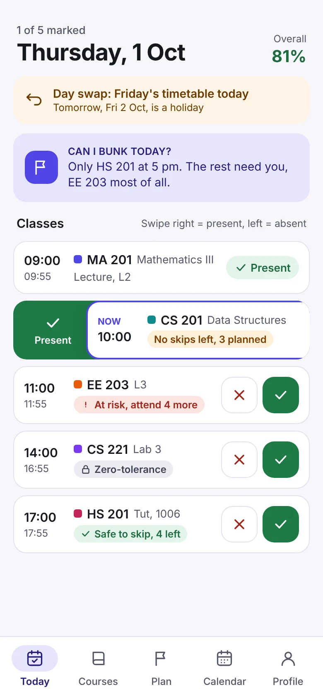
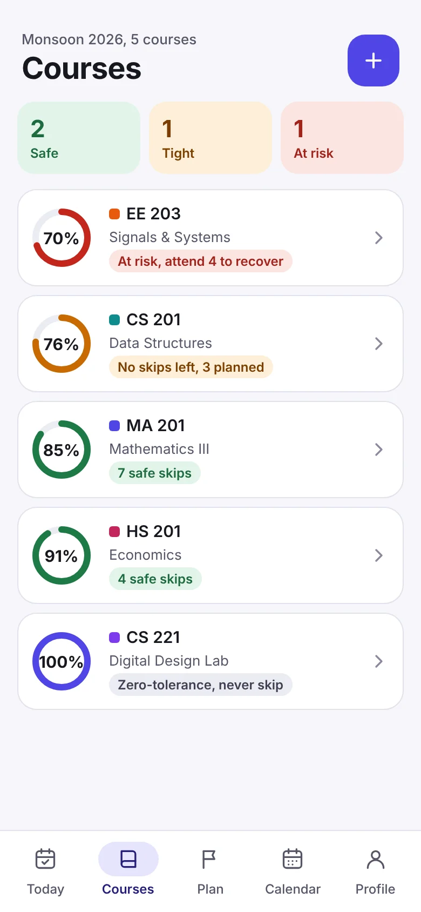
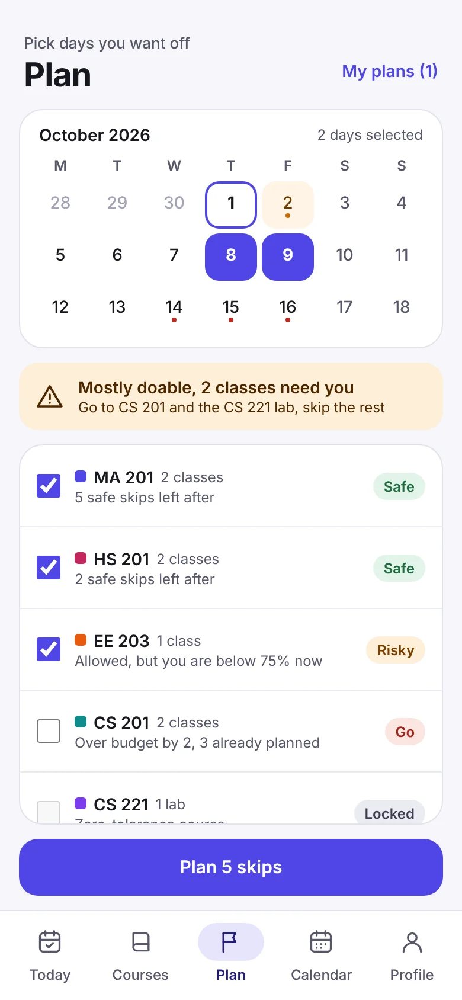
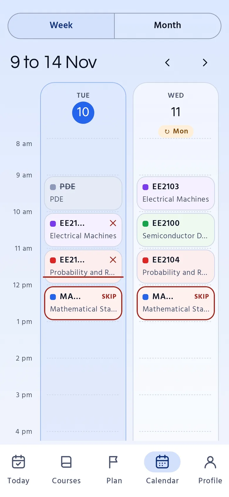
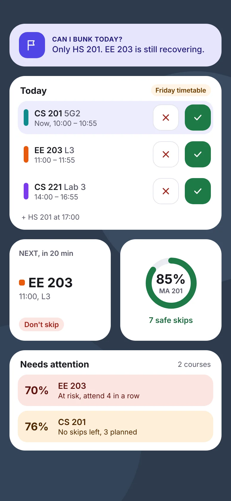
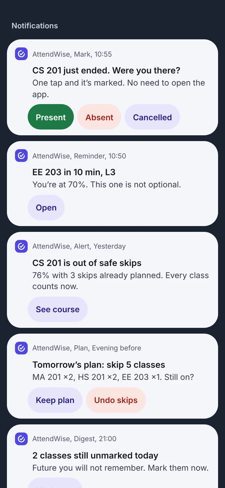
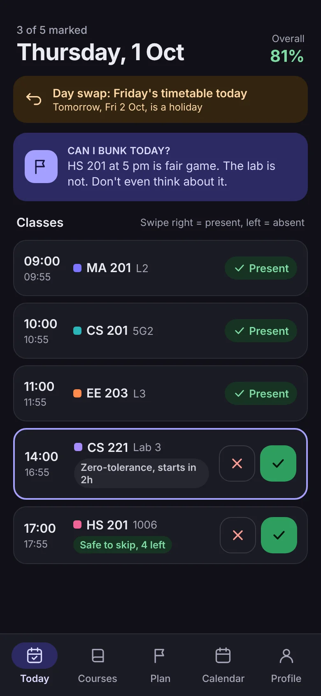

<p align="center">
  
</p>

<h1 align="center">AttendWise</h1>

<p align="center">
  <strong>Know where your attendance stands.</strong><br>
  A native Android app for college attendance, made for IIT Guwahati students.
</p>

<p align="center">
  <a href="https://priyanshuiitghy2006.github.io/AttendWise/"></a>
  
  
</p>

<p align="center">
  <a href="https://priyanshuiitghy2006.github.io/AttendWise/">Website</a> |
  <a href="#features">Features</a> |
  <a href="#install">Install</a> |
  <a href="#how-it-works">How it works</a> |
  <a href="#building-and-testing">Build</a> |
  <a href="https://priyanshuiitghy2006.github.io/AttendWise/terms.html">Terms</a>
</p>

<p align="center">
  <a href="https://github.com/PriyanshuIITGHY2006/AttendWise/actions/workflows/ci.yml"></a>
  <a href="https://github.com/PriyanshuIITGHY2006/AttendWise/actions/workflows/pages.yml"></a>
</p>

<br>

<p align="center">
  
  
  
  
</p>

<p align="center">
  <sub>Today, Courses, Plan and Calendar. These are design mockups of the main screens.</sub>
</p>

<br>

## About

AttendWise keeps your timetable, counts every class, and shows how many classes you can still miss in each course before you drop under the attendance requirement. It runs fully offline, puts your day on the home screen with widgets, and lets you mark a class from the notification without opening the app.

AttendWise is an attendance tracker. It does not encourage anyone to skip classes, and its figures are estimates, not official records. Please read the [terms and conditions](https://priyanshuiitghy2006.github.io/AttendWise/terms.html).

## Features

- **Today.** The day's classes with swipe or tap marking (present or absent), a day swap notice, and a "Can I bunk today?" verdict.
- **Courses.** An attendance ring per course, how many safe skips are left, and zero-tolerance courses such as labs flagged so they are never skipped by accident. Each course has its own requirement.
- **Course detail.** Attended, missed, left and planned classes, what you need to recover, a projection to the end of the semester, the course timetable and the marking history.
- **Plan.** Pick the days you want off and see, per course, whether those classes are safe, risky or must be attended. Plans can be applied and undone.
- **Calendar.** The institute calendar with holidays, exams and day swaps, so a Thursday that runs Friday's timetable shows Friday's classes.
- **Widgets.** Five home screen widgets: today's classes, next class, course ring, "Can I bunk today?" and courses that need attention. Classes can be marked from the widget.
- **Notifications.** A reminder before each class and a prompt after it, with Present, Absent and Cancelled buttons on the notification. Reminders the evening before a planned skip, a daily digest of unmarked classes, quiet hours, and three wording styles (roast, plain, kuchupuchu).
- **Works offline.** Everything runs from the on-device database. Sync happens in the background when there is a network.
- **Themes.** Light, dark or follow the system, plus a launcher icon that changes colour with your attendance.
- **In-app updates.** The app checks GitHub Releases for a newer build and installs it from inside the app.

<p align="center">
  
  
  
</p>

<p align="center">
  <sub>Widgets, notifications with action buttons, and dark mode.</sub>
</p>

## Install

1. Download the latest APK from the [website](https://priyanshuiitghy2006.github.io/AttendWise/) or from [Releases](https://github.com/PriyanshuIITGHY2006/AttendWise/releases).
2. Open the downloaded `.apk` file. If Android asks, allow your browser to install apps.
3. Sign in with Google or an email address. Data from the old website does not carry over, so add your courses again.

Requires Android 8.0 (API 26) or newer. There is no iPhone version.

Each release has up to two APKs:

| File | What it is |
|---|---|
| `AttendWise-<n>.apk` | The signed app. Only present when the release signing key is set up in CI. |
| `AttendWise-test-<n>.apk` | A test build. It installs next to the real app as "AttendWise test" with a `.debug` package name. |

`<n>` is the CI run number. It is also the `versionCode`, and the version name is `2.0.<n>`.

## How it works

- **Offline first.** The on-device database (Room) is the only thing screens and widgets read. Supabase is a sync and backup target, not a live dependency.
- **Classes are computed, not stored.** A pure Kotlin function turns the semester, the timetable and the institute calendar into the list of classes. Only marks are stored and synced.
- **One place for writes.** Every change from a screen, widget or notification goes through one repository. It writes the database, refreshes the widgets, reschedules the alarms and queues a sync.
- **Notifications are scheduled on the device.** There is no Firebase project and no push server.
- **Accounts and sync.** Sign in with Google or email through Supabase. Data is owner-only, enforced by row level security.

## Project layout

| Path | What it holds |
|---|---|
| `domain/` | Pure Kotlin. Every attendance rule: class generation from the timetable and institute calendar, attendance maths, the planner, next-class and notification timing, validation. No Android dependency, fully unit-tested. Built as a separate included build. |
| `app/` | The Android app: Jetpack Compose screens and theme (`ui/`), Room database, Supabase client and sync (`data/`), alarms and notifications (`notify/`), Glance widgets (`widget/`). |
| `supabase/migrations/` | The database schema, applied in order. |
| `site/` | The website and the download page (static HTML, deployed to GitHub Pages). |
| `docs/` | Plans and decisions: [`V2_PLAN.md`](docs/V2_PLAN.md) and [`REBUILD_HANDOFF.md`](docs/REBUILD_HANDOFF.md). |
| `.github/workflows/` | `ci.yml` builds, tests and publishes the APKs. `pages.yml` deploys the website. |

## Building and testing

Requires JDK 17 or newer (CI uses 21). Building the app also needs the Android SDK with platform 37.

Run the attendance rules tests. They need only a JDK:

```bash
./gradlew -p domain test
```

The report is written to `domain/build/reports/tests/test/index.html`.

Build the test and release APKs:

```bash
./gradlew :app:assembleDebug :app:assembleRelease -PversionCode=1
```

Release builds are signed only when a keystore and a `signing.properties` file are present in `app/signing/`. CI unpacks them from the `SIGNING_KEY` secret. Without them the release APK is unsigned. Test builds use a fixed, non-secret debug key so they install over each other.

## CI and releases

- `ci.yml` runs on pushes to `v2-native` and `dev`, and on pull requests. It runs the domain tests, builds both APKs, and on `v2-native` publishes a pre-release named `v2-build-<n>` with the APKs attached.
- Changes that only touch `site/`, `docs/` or Markdown files do not run CI, so editing the website or the docs does not rebuild the app or publish a new build.
- Only one CI run per branch is active at a time. A newer push cancels the older run.

## Website

`site/` is deployed by `pages.yml` to GitHub Pages whenever a push to `v2-native` changes it.

- `index.html` is the landing page. The Download button reads the GitHub Releases API and links the newest `AttendWise-<n>.apk`, falling back to `AttendWise-test-<n>.apk`, and shows the release date and size under it.
- `terms.html` holds the terms and conditions.
- `sw.js` is a stub that clears the offline cache the old website installed, so returning visitors see the current page.
- `404.html` is created from `index.html` during the deploy.

## Branches

`v2-native` is the active development branch. The earlier React and Capacitor web app is retired.

## Author

Built by Priyanshu Debnath. Questions, bugs and ideas are welcome.

- Email: [priyanshuib01@gmail.com](mailto:priyanshuib01@gmail.com)
- GitHub: [PriyanshuIITGHY2006](https://github.com/PriyanshuIITGHY2006)

AttendWise is an independent project and is not affiliated with IIT Guwahati or any other institute.
